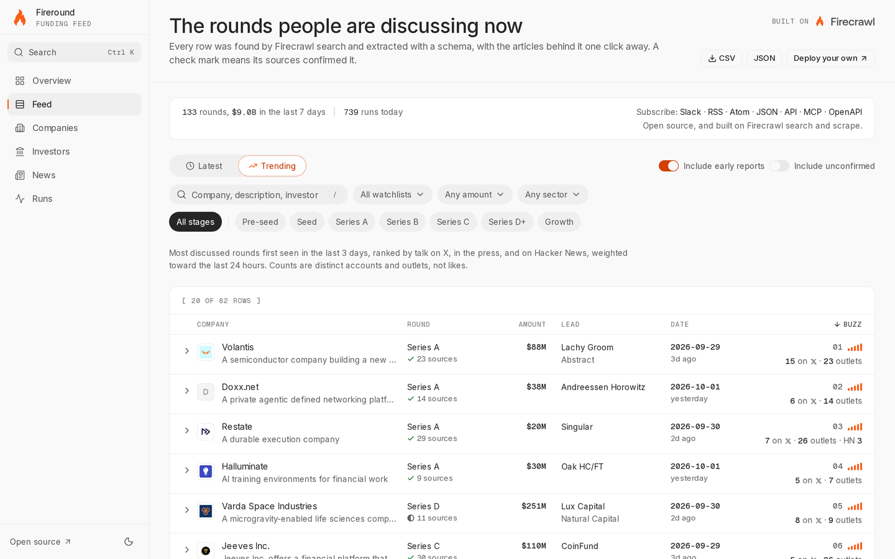
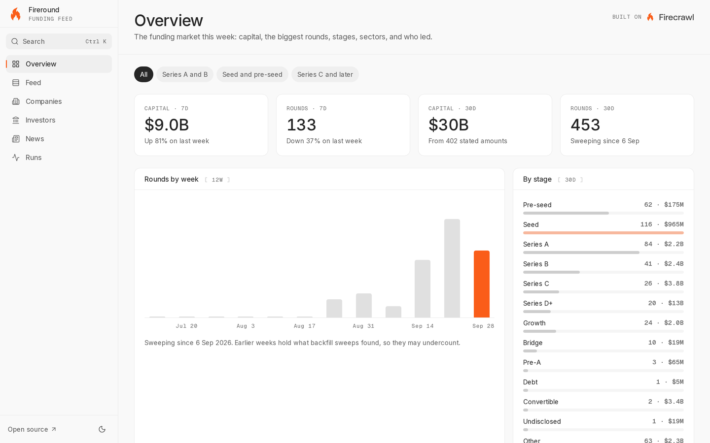
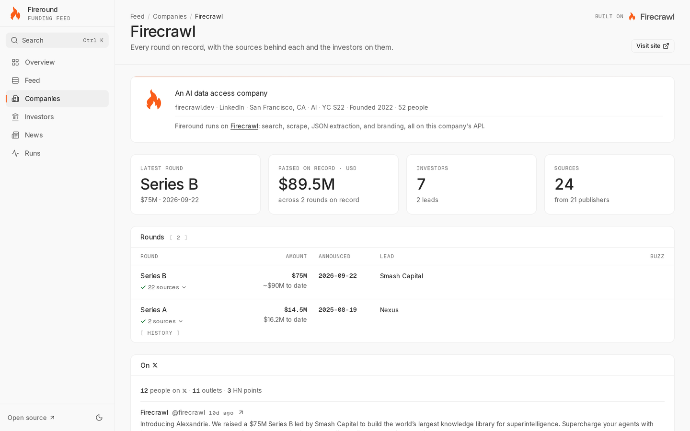
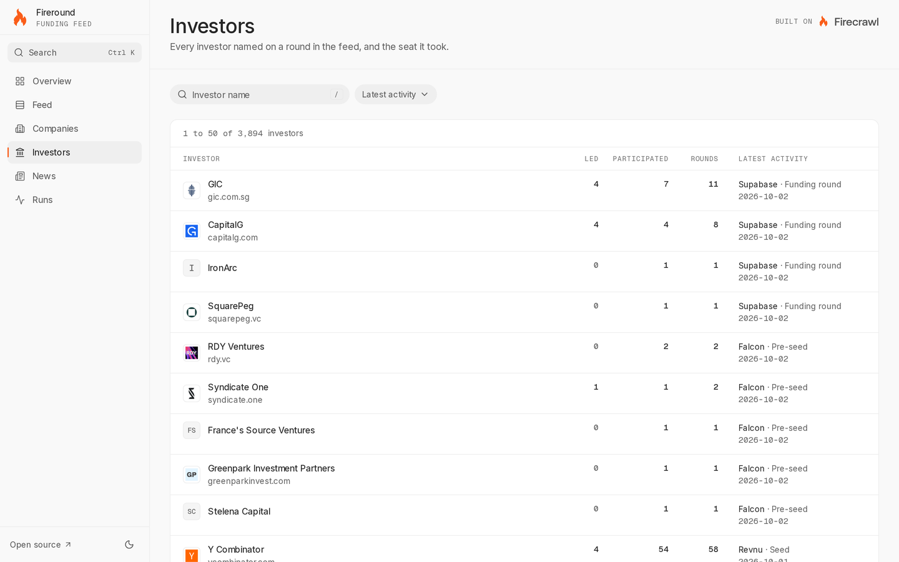
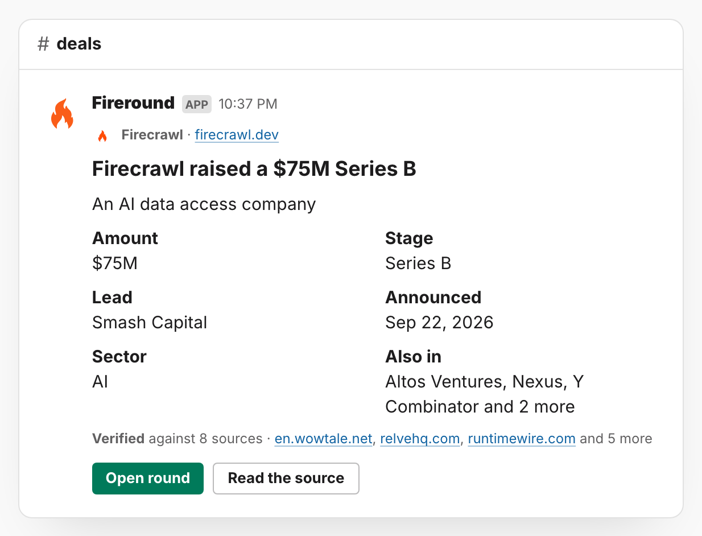

# Fireround

The open-source funding feed built on [Firecrawl](https://www.firecrawl.dev). Fireround finds funding announcements from across the open web, pre-seed to growth, reads each one into a structured record, checks it against the pages that reported it, and serves the result as a dashboard, feeds, an API, and an MCP server.

**Live at [fireround.dev](https://fireround.dev).**

[](https://vercel.com/new/clone?repository-url=https%3A%2F%2Fgithub.com%2Ffirecrawl%2Ffireround&env=FIRECRAWL_API_KEY%2CDASHBOARD_PASSWORD%2CCRON_SECRET%2CMCP_API_KEY&envDescription=Your%20Firecrawl%20API%20key%2C%20a%20dashboard%20password%2C%20and%20separate%20random%20secrets%20for%20cron%20and%20MCP&envLink=https%3A%2F%2Fwww.firecrawl.dev%2Fapp%2Fapi-keys&stores=%5B%7B%22type%22%3A%22integration%22%2C%22protocol%22%3A%22storage%22%2C%22productSlug%22%3A%22neon%22%2C%22integrationSlug%22%3A%22neon%22%7D%5D)

The supplied sub-daily cron schedules require **Vercel Pro**. On Hobby, replace them with a daily cron and use an external scheduler or GitHub Actions to call the other routes with `CRON_SECRET`; see [the deployment guide](docs/deploy.md#vercel-hobby).

[](https://github.com/firecrawl/fireround/actions/workflows/ci.yml)
[](LICENSE)
[](https://nodejs.org)


<details>
<summary>Screenshots: the feed, the overview, a company page, the investors index, a round in Slack</summary>











</details>

## Why

Funding data is usually paywalled, and it is often stale by the time it reaches you. Fireround rebuilds it from primary sources for a few thousand Firecrawl credits a month per preset. Every row is read back against the pages that reported it before it publishes, and every row links to those pages.

## What you get

- **Feed**: every round with its logo, stage, amount, lead, date, and source check. Filter by stage, preset, amount, and sector; open a row for the evidence sentence and the field-by-field verdict. A Trending view ranks rounds first seen in the last three days by how much they are discussed on X, in the press, and on Hacker News.
- **Companies and investors**: a searchable index and a page for each, with every round on record, total raised, the syndicate, logos, and sourced company facts. Deep dive builds a company dossier on demand, checked claim by claim before it is saved.
- **Overview and news**: the market at a glance, and the articles behind the records grouped by day. Cmd+K finds any company or investor.
- **Presets**: what to watch. Series A and B is the default; seed and pre-seed, and Series C and later, ship too. Add your own in the UI, priced before it runs.
- **Review**: undated or low-confidence rows to publish, reject, or research, with keyboard shortcuts and undo.
- **Delivery**: Slack (one click once the app is set up, [docs/slack.md](docs/slack.md)), RSS, Atom, and JSON Feed, signed webhooks ([Standard Webhooks](https://www.standardwebhooks.com)), and, optionally for self-hosters with a Resend key, a daily or weekly email digest. Company and investor links unfurl as share cards.
- **API and MCP**: JSON, CSV, and JSONL over `/api/v1` with an OpenAPI spec, and six MCP tools (eight with company requests on).
- **Runs**: every sweep and lane with the credits it was estimated to cost beside the credits it measured.

## Quick start

Requires Node 24+ and pnpm (`corepack enable` installs the version `package.json` pins).

```bash
git clone https://github.com/firecrawl/fireround.git && cd fireround
pnpm install
cp .env.example .env   # paste your Firecrawl key: https://www.firecrawl.dev/app/api-keys
pnpm dev               # http://localhost:3000
```

No database to set up: without `DATABASE_URL` the app runs on embedded Postgres ([PGlite](https://pglite.dev)) under `./data`. An empty store opens on one panel that explains the first sweep, prices it, and runs it: last week of Series A and B, about ten minutes and about 630 to 690 credits, which fits in [Firecrawl's free plan](https://www.firecrawl.dev/pricing).

## Deploy

**Vercel.** Press **Deploy with Vercel** above. It asks for your Firecrawl key, a dashboard password, a cron secret, and an MCP API key, and provisions a Neon database. Migrations apply at build. The supplied Vercel Cron schedules require Pro; Hobby hosts can use the external-scheduler setup linked above. Add `AI_GATEWAY_API_KEY` afterwards to turn on the cross-source read-back and Deep dive.

**Anywhere else.** Point `DATABASE_URL` at any Postgres 15+, then `pnpm db:migrate && pnpm build && pnpm start`. A production `pnpm start` runs the hourly schedule itself.

Public instances, Slack, and who can reach what: [docs/deploy.md](docs/deploy.md).

## Configuration

Only `FIRECRAWL_API_KEY` is required. The ones most deployments set:

| Variable | Purpose |
|---|---|
| `FIRECRAWL_API_KEY` | Your Firecrawl key |
| `DATABASE_URL` | Any Postgres 15+; unset uses embedded PGlite |
| `DASHBOARD_PASSWORD` | HTTP Basic auth on the dashboard and `/api/v1`; unset means open |
| `CRON_SECRET` | Bearer for the cron routes; Vercel sends it on every scheduled call |
| `MCP_API_KEY` | Bearer for `/api/mcp`; required to enable MCP on a password-protected private deployment |
| `ALEXANDRIA_API_KEY` | Bearer Firecrawl's Alexandria sends to `/api/v1` on a public demo; its calls skip the per-address budgets and read the same public rows ([docs/deploy.md](docs/deploy.md#alexandria)) |
| `AI_GATEWAY_API_KEY` | Reads every record against all its sources with a model before it publishes (or set an OpenAI, OpenRouter, or Anthropic key) |
| `APP_ORIGIN` | Your public URL, for webhooks, Slack links, and share cards |

Every variable: [docs/configuration.md](docs/configuration.md).

**Coverage** is one setting that decides how wide the net is and how often it runs. Lite, the default, sweeps the news once a week: about 3.3K to 3.6K credits a month for the Series A and B preset, and about 10K for all three shipped presets. Max runs every lane hourly. Settings prices each rung against your presets before you switch: [docs/coverage.md](docs/coverage.md).

## API, feeds, and MCP

- `GET /api/v1/rounds` returns JSON, CSV, or JSONL with cursor pagination and a `certainty` field; filter with `?certainty=announced`, `reported`, `expected`, or `unconfirmed`. A CSV without `limit` is the whole filtered set, up to 10,000 rows. `GET /api/v1/runs` lists runs. The spec is at `/api/v1/openapi.json`; [docs/api.md](docs/api.md) explains the certainty contract. On a public demo, a visitor's reads are open to any origin (CORS) and cached at the edge for a minute; an admin's are neither.
- Feeds live at `/feeds/<token>/<preset>.rss`, `.atom`, or `.json`. Mint a token in Settings or with `pnpm feed-token`.
- The MCP server at `/api/mcp` has `list_rounds`, `search_rounds`, `get_company`, `list_trending`, `mark_seen`, and `list_presets`. Set `MCP_API_KEY` and send `Authorization: Bearer <key>`; a password-protected private deployment refuses MCP without it. A keyless `PUBLIC_DEMO=1` instance keeps public read tools but omits `mark_seen`. With `COMPANY_REQUESTS=1` it adds `request_company` and `company_request_status`, under the same checks and daily caps as the request page, and the OpenAPI spec lists `POST /api/company-requests` and `GET /api/company-requests/{id}`; requested rounds are stored as history and never delivered ([docs/how-it-works.md](docs/how-it-works.md)).

## How Fireround uses Firecrawl

Every record starts with the [Firecrawl API](https://docs.firecrawl.dev) through the [Node SDK](https://docs.firecrawl.dev/sdks/node). Each call below links to the code that makes it.

| Firecrawl | What Fireround does with it | Code |
|---|---|---|
| [Search](https://docs.firecrawl.dev/features/search) | Runs each preset's eight queries over news and the web with a recency window, and finds company homepages, investor sites, and posts on X | [`sweep.ts`](packages/core/src/firecrawl/sweep.ts), [`trending/x.ts`](packages/core/src/trending/x.ts) |
| [Scrape](https://docs.firecrawl.dev/features/scrape) with [JSON mode](https://docs.firecrawl.dev/features/llm-extract) | Reads each article into a funding-round schema; one extraction covers every round on a roundup page | [`extract.ts`](packages/core/src/firecrawl/extract.ts) |
| Scrape with the [`branding` format](https://docs.firecrawl.dev/features/scrape#extract-brand-identity) | Reads the logo, the brand name, and the primary colour off company and investor homepages | [`enrich.ts`](packages/core/src/firecrawl/enrich.ts), [`investor-enrich.ts`](lib/investor-enrich.ts) |
| Scrape with the `links` format | Reads 27 publisher funding sections and daily funding lists, in every region, and extracts only the articles not seen before | [`watch.ts`](packages/core/src/firecrawl/watch.ts) |
| [Map](https://docs.firecrawl.dev/features/map) | Finds a company's own announcement on its site to corroborate a round | [`corroborate.ts`](packages/core/src/firecrawl/corroborate.ts) |
| [Monitoring](https://docs.firecrawl.dev/features/monitoring-web-scale) | Runs a preset's queries on a schedule inside Firecrawl and posts new pages to `/api/webhooks/firecrawl` | [`monitor.ts`](packages/core/src/firecrawl/monitor.ts) |
| [Agent](https://docs.firecrawl.dev/features/agent) | Research fills a record's gaps from its sources; Deep dive builds a company dossier | [`gapfill.ts`](packages/core/src/firecrawl/gapfill.ts), [`deepdive.ts`](packages/core/src/firecrawl/deepdive.ts) |
| [Alexandria](https://docs.firecrawl.dev/features/alexandria) | Adds sourced facts on each verified domain: the Y Combinator record, FullEnrich firmographics, and Apollo's headcount and LinkedIn page | [`alexandria.ts`](packages/core/src/firecrawl/alexandria.ts) |

Firecrawl launched Alexandria on September 22, 2026, alongside its Series B: [Introducing Alexandria and our $75M Series B](https://www.firecrawl.dev/blog/introducing-alexandria-series-b).

## How it works

Sweeps search for each preset's queries and extract every round from the articles they find. Watched publisher sections, stage-free searches, monitors, X, and SEC Form D filings catch what the sweep misses. Every record is grounded in its page's own text, deduped against the store, and read back against its sources before it publishes, then enriched with the company's homepage profile, its logo, and Alexandria's facts.

- [docs/how-it-works.md](docs/how-it-works.md): the lanes, verification, dossiers, and history rounds
- [docs/data-quality.md](docs/data-quality.md): the rules that keep the data honest
- [docs/coverage.md](docs/coverage.md): what each coverage rung turns on and what it costs
- [docs/deploy.md](docs/deploy.md) and [docs/configuration.md](docs/configuration.md): hosting and every variable
- [docs/slack.md](docs/slack.md): the three ways to get rounds into Slack
- [docs/scripts.md](docs/scripts.md): every `pnpm` script

## Development

```bash
pnpm test        # the suite on an in-memory Postgres; no network, no key
pnpm typecheck
pnpm lint
```

Next.js 16, React 19, TypeScript, Tailwind 4 and shadcn/ui, Drizzle over PGlite or Postgres, the Vercel Workflow SDK, and the AI SDK. The repo layout and the house rules: [CONTRIBUTING.md](CONTRIBUTING.md).

## Contributing

Issues and pull requests are welcome. [CONTRIBUTING.md](CONTRIBUTING.md) covers the three gates, adding a preset or a data-quality rule, and the house rules for prose. Report security problems privately through [SECURITY.md](SECURITY.md), not in a public issue.

## License

MIT. See [LICENSE](LICENSE).
